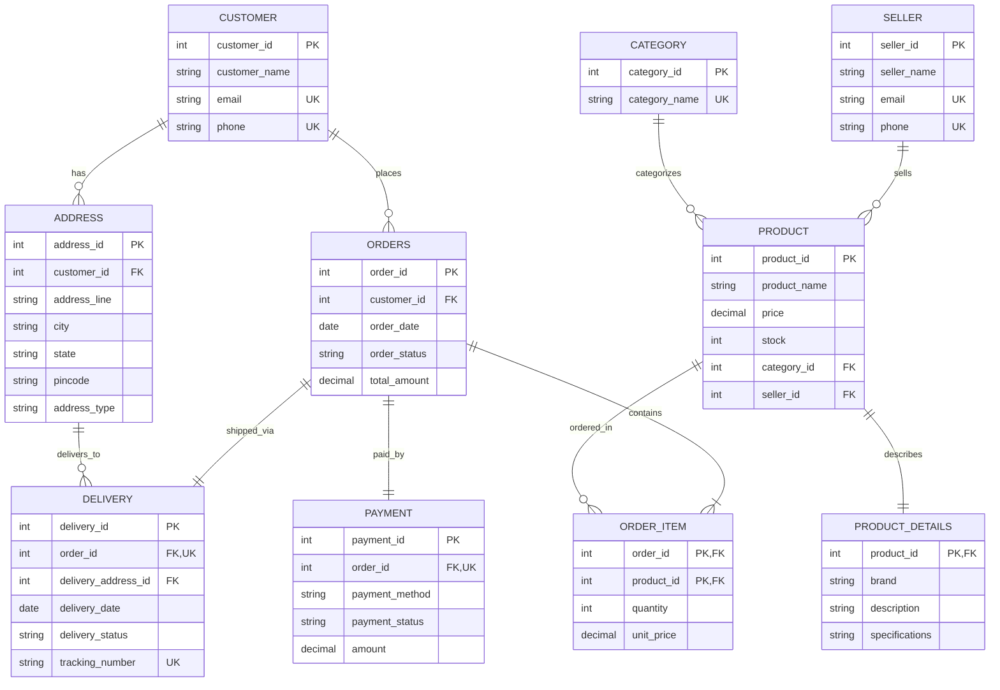
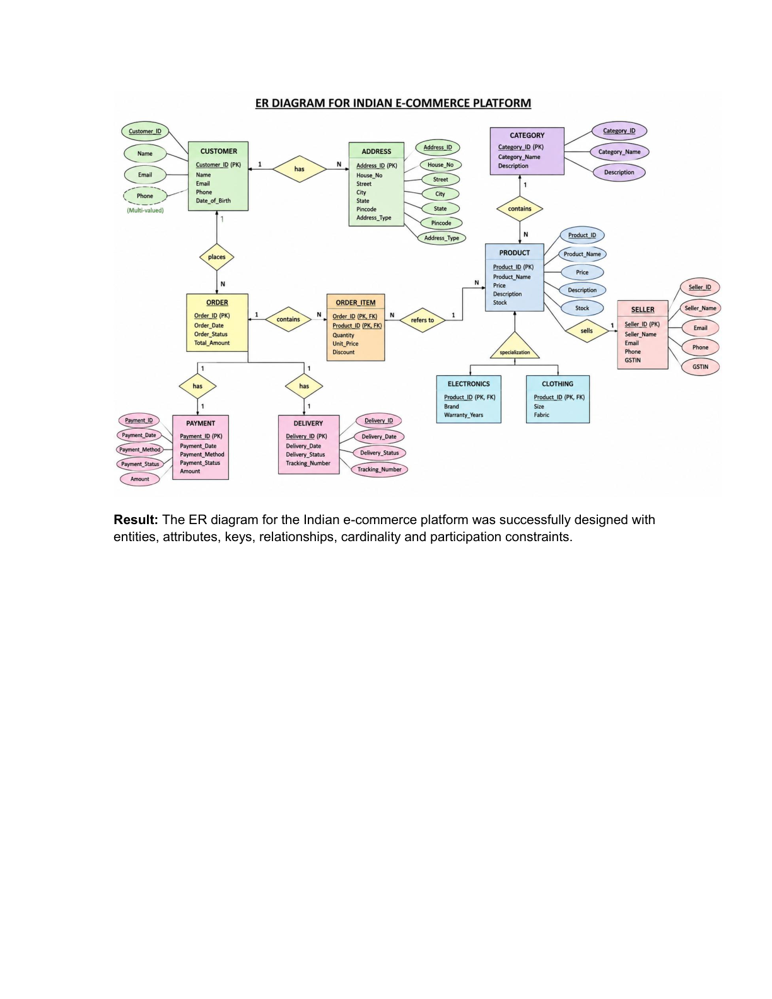

# Experiment 01: Design an ER Diagram for Indian E-Commerce Platform

- **Course Outcome**: `CO1` (Understand and model data requirements using Entity-Relationship modeling)
- **Environment**: MySQL 8.0+ / MySQL Workbench / ERD Tools

---

## 1. Aim
To design and document a comprehensive Entity-Relationship (ER) diagram for an Indian e-commerce platform incorporating real-world business entities, relational constraints, multi-entity relationships, cardinality ratios, and specialization hierarchies.

---

## 2. Theory

### 2.1 Entity-Relationship (ER) Modeling
Entity-Relationship (ER) modeling is a high-level conceptual data modeling methodology proposed by Peter Chen in 1976. It visually describes the logical structure of a database in terms of:
- **Entities**: Real-world objects distinguishable from other objects (e.g., Customer, Product, Order).
- **Attributes**: Properties or characteristics describing an entity (e.g., `customer_name`, `price`).
  - *Key Attribute*: Uniquely identifies each entity instance (e.g., `customer_id`).
  - *Composite Attribute*: Composed of multiple sub-components (e.g., Address composed of City, State, Pincode).
  - *Derived Attribute*: Calculated from other attributes (e.g., age from date of birth).
  - *Multivalued Attribute*: Can hold multiple values for a single entity (e.g., multiple phone numbers).
- **Relationships**: Associations among two or more entities (e.g., Customer *places* Order).

### 2.2 Cardinality & Participation Constraints
- **Cardinality Ratio**: Specifies the maximum number of relationship instances in which an entity can participate:
  - **One-to-One (1:1)**: E.g., An Order has exactly one Payment transaction.
  - **One-to-Many (1:N)**: E.g., A Customer places multiple Orders.
  - **Many-to-Many (M:N)**: E.g., An Order contains multiple Products, and a Product appears in multiple Orders (resolved via `OrderItem` associative entity).
- **Participation Constraint**: Specifies whether the existence of an entity depends on its being related to another entity via the relationship type (Total vs. Partial participation).

### 2.3 Indian E-Commerce Business Context
An Indian e-commerce platform incorporates domain-specific requirements:
- Multilingual and regional shipping across diverse states and PIN codes.
- Localized payment methods including **UPI (Unified Payments Interface)**, Net Banking, Credit/Debit Cards, and **Cash on Delivery (COD)**.
- Multiple merchant sellers registered under GST guidelines.
- Split order dispatch and itemized shipping tracking.

---

## 3. Entities and Attributes

| Entity | Primary Key | Attributes | Description |
| :--- | :--- | :--- | :--- |
| **Customer** | `customer_id` | `customer_name`, `email`, `phone` | Registered retail buyers on the platform |
| **Address** | `address_id` | `customer_id` (FK), `address_line`, `city`, `state`, `pincode`, `address_type` | Delivery addresses linked to customers |
| **Seller** | `seller_id` | `seller_name`, `email`, `phone` | Third-party Indian marketplace sellers |
| **Category** | `category_id` | `category_name` | Product taxonomy (Electronics, Apparel, Books) |
| **Product** | `product_id` | `product_name`, `price`, `stock`, `category_id` (FK), `seller_id` (FK) | Catalog items listed by sellers |
| **Product_Details** | `product_id` | `brand`, `description`, `specifications` | Detailed specifications (1:1 extension) |
| **Orders** | `order_id` | `customer_id` (FK), `order_date`, `order_status`, `total_amount` | Purchase orders placed by customers |
| **OrderItem** | (`order_id`, `product_id`) | `quantity`, `unit_price` | Itemized line records forming the order |
| **Payment** | `payment_id` | `order_id` (FK), `payment_method`, `payment_status`, `amount` | Transaction processing records (UPI/Card/COD) |
| **Delivery** | `delivery_id` | `order_id` (FK), `delivery_address_id` (FK), `delivery_date`, `delivery_status`, `tracking_number` | Fulfillment and logistics tracking |

---

## 4. Entity Relationships & Cardinality

- **Customer places Order** &rarr; `1:N` (One customer can place many orders; each order belongs to one customer).
- **Customer has Address** &rarr; `1:N` (One customer can save multiple delivery addresses).
- **Order contains OrderItem** &rarr; `1:N` (An order includes one or more line items).
- **Product belongs to Category** &rarr; `N:1` (Many products belong to a single category).
- **Seller lists Product** &rarr; `1:N` (A seller sells multiple catalog products).
- **Order has Payment** &rarr; `1:1` (Each order is tied to one consolidated payment record).
- **Order has Delivery** &rarr; `1:1` (Each order is fulfilled via a designated delivery shipment).
- **OrderItem references Product** &rarr; `N:1` (Each order item specifies one product).
- **Product Specialization**: Products specialize into categories such as Electronics and Clothing.

---

## 5. ER Diagram

### 5.1 Diagrammatic Representation (Mermaid)



### 5.2 Visual ER Diagram


---

## 6. Complete SQL Implementation

See the full script in [`queries.sql`](queries.sql).

```sql
-- Create Database
CREATE DATABASE IF NOT EXISTS ecommerce_db;
USE ecommerce_db;

-- Customer Table
CREATE TABLE IF NOT EXISTS Customer (
    customer_id INT PRIMARY KEY,
    customer_name VARCHAR(100) NOT NULL,
    email VARCHAR(100) NOT NULL UNIQUE,
    phone VARCHAR(15) UNIQUE
);

-- Address Table
CREATE TABLE IF NOT EXISTS Address (
    address_id INT PRIMARY KEY,
    customer_id INT NOT NULL,
    address_line VARCHAR(200) NOT NULL,
    city VARCHAR(50) NOT NULL,
    state VARCHAR(50) NOT NULL,
    pincode VARCHAR(10) NOT NULL,
    address_type VARCHAR(20) DEFAULT 'Home',
    FOREIGN KEY (customer_id) REFERENCES Customer(customer_id)
        ON DELETE CASCADE
);

-- Seller Table
CREATE TABLE IF NOT EXISTS Seller (
    seller_id INT PRIMARY KEY,
    seller_name VARCHAR(100) NOT NULL,
    email VARCHAR(100) NOT NULL UNIQUE,
    phone VARCHAR(15) UNIQUE
);

-- Category Table
CREATE TABLE IF NOT EXISTS Category (
    category_id INT PRIMARY KEY,
    category_name VARCHAR(100) NOT NULL UNIQUE
);

-- Product Table
CREATE TABLE IF NOT EXISTS Product (
    product_id INT PRIMARY KEY,
    product_name VARCHAR(100) NOT NULL,
    price DECIMAL(10,2) NOT NULL,
    stock INT NOT NULL DEFAULT 0,
    category_id INT,
    seller_id INT,
    FOREIGN KEY (category_id) REFERENCES Category(category_id)
        ON DELETE SET NULL,
    FOREIGN KEY (seller_id) REFERENCES Seller(seller_id)
        ON DELETE SET NULL
);

-- Product Details Table
CREATE TABLE IF NOT EXISTS Product_Details (
    product_id INT PRIMARY KEY,
    brand VARCHAR(100),
    description VARCHAR(255),
    specifications TEXT,
    FOREIGN KEY (product_id) REFERENCES Product(product_id)
        ON DELETE CASCADE
);

-- Orders Table
CREATE TABLE IF NOT EXISTS Orders (
    order_id INT PRIMARY KEY,
    customer_id INT NOT NULL,
    order_date DATE NOT NULL,
    order_status VARCHAR(30) NOT NULL,
    total_amount DECIMAL(10,2) NOT NULL DEFAULT 0.00,
    FOREIGN KEY (customer_id) REFERENCES Customer(customer_id)
        ON DELETE CASCADE
);

-- OrderItem Table
CREATE TABLE IF NOT EXISTS OrderItem (
    order_id INT,
    product_id INT,
    quantity INT NOT NULL,
    unit_price DECIMAL(10,2) NOT NULL,
    PRIMARY KEY (order_id, product_id),
    FOREIGN KEY (order_id) REFERENCES Orders(order_id)
        ON DELETE CASCADE,
    FOREIGN KEY (product_id) REFERENCES Product(product_id)
        ON DELETE CASCADE
);

-- Payment Table
CREATE TABLE IF NOT EXISTS Payment (
    payment_id INT PRIMARY KEY,
    order_id INT NOT NULL UNIQUE,
    payment_method VARCHAR(30) NOT NULL,
    payment_status VARCHAR(30) NOT NULL,
    amount DECIMAL(10,2) NOT NULL,
    FOREIGN KEY (order_id) REFERENCES Orders(order_id)
        ON DELETE CASCADE
);

-- Delivery Table
CREATE TABLE IF NOT EXISTS Delivery (
    delivery_id INT PRIMARY KEY,
    order_id INT NOT NULL UNIQUE,
    delivery_address_id INT,
    delivery_date DATE,
    delivery_status VARCHAR(30) NOT NULL,
    tracking_number VARCHAR(50) UNIQUE,
    FOREIGN KEY (order_id) REFERENCES Orders(order_id)
        ON DELETE CASCADE,
    FOREIGN KEY (delivery_address_id) REFERENCES Address(address_id)
        ON DELETE SET NULL
);
```

---

## 7. Sample Input Data & Expected Output

### Sample Input Insertion
```sql
INSERT INTO Customer VALUES
(1, 'Rahul Sharma', 'rahul@gmail.com', '9876543210'),
(2, 'Priya Singh', 'priya@gmail.com', '9876543211'),
(3, 'Aman Verma', 'aman@gmail.com', '9876543212');

INSERT INTO Category VALUES
(301, 'Electronics'),
(302, 'Books'),
(303, 'Clothing');
```

### Expected Output: Tables Preview
```text
mysql> SELECT customer_id, customer_name, email, phone FROM Customer;
+-------------+---------------+-----------------+------------+
| customer_id | customer_name | email           | phone      |
+-------------+---------------+-----------------+------------+
|           1 | Rahul Sharma  | rahul@gmail.com | 9876543210 |
|           2 | Priya Singh   | priya@gmail.com | 9876543211 |
|           3 | Aman Verma    | aman@gmail.com  | 9876543212 |
+-------------+---------------+-----------------+------------+
3 rows in set (0.00 sec)

mysql> SELECT * FROM Category;
+-------------+---------------+
| category_id | category_name |
+-------------+---------------+
|         301 | Electronics   |
|         302 | Books         |
|         303 | Clothing      |
+-------------+---------------+
3 rows in set (0.00 sec)
```

---

## 8. Result / Conclusion
The Entity-Relationship (ER) diagram for the Indian e-commerce platform was successfully designed and modeled. All 10 key entities, primary keys, foreign key constraints, relationship cardinalities (1:1, 1:N, M:N), and specialized attributes were defined and validated.
