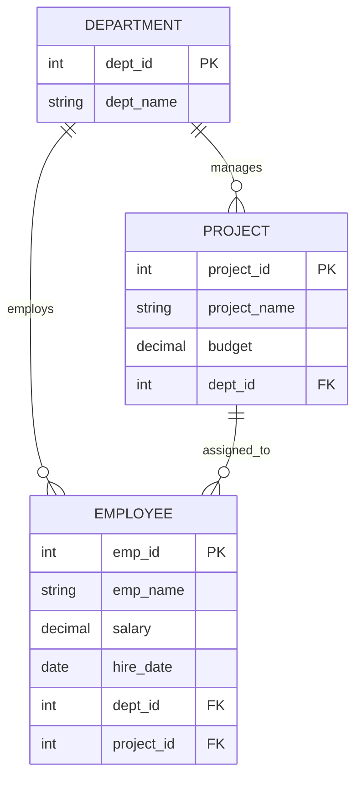

# Experiment 03: SQL Queries - Selection, Projection, Aggregations, GROUP BY, HAVING, CASE, and JOINs

- **Course Outcome**: `CO3` (Formulate and execute SQL queries using operators, aggregation, grouping, and joins)
- **Environment**: MySQL 8.0+ / MySQL Workbench

---

## 1. Aim
To create an Employee–Department–Project relational database (`CompanyDB`), populate at least 30 employees across 5 departments and 8 projects, and demonstrate SQL queries using **Selection**, **Projection**, **Aggregate Functions** (`COUNT`, `AVG`, `SUM`, `MIN`, `MAX`), **GROUP BY**, **HAVING**, conditional **CASE** expressions, **ORDER BY**, and **multi-table JOINs**.

---

## 2. Theory

### 2.1 Fundamental Relational Query Operations
- **Selection ($\sigma$)**: Filters rows based on a specified boolean predicate using the `WHERE` clause (e.g., `WHERE salary > 70000`).
- **Projection ($\pi$)**: Restricts the returned column set to only specified attributes (e.g., `SELECT emp_name, salary`).
- **Sorting (`ORDER BY`)**: Orders the output tuple set ascending (`ASC`) or descending (`DESC`) across one or multiple columns.

### 2.2 Aggregate Functions and Grouping
- **Aggregate Functions**: Operate on sets of values to calculate single scalar summary statistics:
  - `COUNT()`: Counts non-null records.
  - `SUM()`: Calculates total numeric value.
  - `AVG()`: Computes arithmetic mean.
  - `MIN()` / `MAX()`: Determines extrema within a partition.
- **`GROUP BY` Clause**: Divides the rows of a table into non-overlapping groups sharing identical values in grouping columns. Aggregations are calculated independently per group.
- **`HAVING` vs. `WHERE`**:
  - `WHERE` filters individual rows *before* grouping occurs.
  - `HAVING` filters aggregated group records *after* grouping is computed.

### 2.3 Conditional Evaluation (`CASE`)
SQL's `CASE` expression allows conditional branching logic within queries, enabling dynamic categorization and value transformation directly inside projection lists.

### 2.4 Multi-Table Joins
An `INNER JOIN` matches rows between two or more tables based on a join condition (equi-join on primary/foreign keys), synthesizing related relational entities into a cohesive result set.

---

## 3. Database Schema Reference



---

## 4. SQL Program

See the full script in [`queries.sql`](queries.sql).

```sql
CREATE DATABASE IF NOT EXISTS CompanyDB;
USE CompanyDB;

CREATE TABLE Department (
    dept_id INT PRIMARY KEY,
    dept_name VARCHAR(50) NOT NULL
);

CREATE TABLE Project (
    project_id INT PRIMARY KEY,
    project_name VARCHAR(100) NOT NULL,
    budget DECIMAL(12,2),
    dept_id INT,
    FOREIGN KEY (dept_id) REFERENCES Department(dept_id)
);

CREATE TABLE Employee (
    emp_id INT PRIMARY KEY,
    emp_name VARCHAR(50) NOT NULL,
    salary DECIMAL(10,2) NOT NULL,
    hire_date DATE NOT NULL,
    dept_id INT,
    project_id INT,
    FOREIGN KEY (dept_id) REFERENCES Department(dept_id),
    FOREIGN KEY (project_id) REFERENCES Project(project_id)
);
```

---

## 5. Sample Data Setup

```sql
INSERT INTO Department VALUES
(1, 'IT'), (2, 'HR'), (3, 'Finance'), (4, 'Marketing'), (5, 'Operations');

INSERT INTO Project VALUES
(101, 'Cloud Migration', 150000.00, 1),
(102, 'AI Analytics', 200000.00, 1),
(103, 'Recruitment Portal', 80000.00, 2),
(104, 'Financial Dashboard', 120000.00, 3),
(105, 'Digital Campaign', 90000.00, 4),
(106, 'Supply Chain System', 180000.00, 5),
(107, 'Mobile Application', 140000.00, 1),
(108, 'Employee Wellness', 60000.00, 2);

INSERT INTO Employee VALUES
(1, 'Aarav', 65000.00, '2022-01-10', 1, 101),
(2, 'Vivaan', 72000.00, '2021-03-15', 1, 102),
(3, 'Aditya', 58000.00, '2023-06-20', 1, 107),
(4, 'Arjun', 81000.00, '2020-08-12', 1, 101),
(5, 'Kabir', 69000.00, '2022-11-05', 1, 102),
(6, 'Reyansh', 62000.00, '2024-02-18', 1, 107),
(7, 'Ananya', 52000.00, '2022-04-11', 2, 103),
(8, 'Diya', 48000.00, '2023-01-22', 2, 108),
(9, 'Myra', 61000.00, '2021-07-19', 2, 103),
(10, 'Sara', 55000.00, '2022-09-30', 2, 108),
(11, 'Ishita', 47000.00, '2024-03-14', 2, 103),
(12, 'Meera', 59000.00, '2020-12-01', 2, 108),
(13, 'Rohan', 75000.00, '2021-02-17', 3, 104),
(14, 'Karan', 68000.00, '2022-05-09', 3, 104),
(15, 'Nikhil', 83000.00, '2019-10-21', 3, 104),
(16, 'Yash', 62000.00, '2023-08-13', 3, 104),
(17, 'Manav', 71000.00, '2021-11-28', 3, 104),
(18, 'Dev', 56000.00, '2024-01-09', 3, 104),
(19, 'Aanya', 54000.00, '2022-02-25', 4, 105),
(20, 'Kiara', 63000.00, '2021-06-16', 4, 105),
(21, 'Tanya', 57000.00, '2023-04-10', 4, 105),
(22, 'Riya', 66000.00, '2020-09-07', 4, 105),
(23, 'Avni', 51000.00, '2024-02-05', 4, 105),
(24, 'Navya', 70000.00, '2022-12-19', 4, 105),
(25, 'Samar', 60000.00, '2021-01-12', 5, 106),
(26, 'Dhruv', 73000.00, '2020-04-23', 5, 106),
(27, 'Atharv', 67000.00, '2022-07-18', 5, 106),
(28, 'Parth', 59000.00, '2023-05-29', 5, 106),
(29, 'Rudra', 76000.00, '2019-08-31', 5, 106),
(30, 'Veer', 64000.00, '2024-01-20', 5, 106);
```

---

## 6. SQL Demonstration Queries & Expected Outputs

### 6.1 Selection Query
Filter employees earning greater than ₹70,000.
```sql
SELECT emp_id, emp_name, salary, hire_date, dept_id, project_id
FROM Employee
WHERE salary > 70000
ORDER BY salary DESC;
```
#### Expected Output:
```text
+--------+----------+----------+------------+---------+------------+
| emp_id | emp_name | salary   | hire_date  | dept_id | project_id |
+--------+----------+----------+------------+---------+------------+
|     15 | Nikhil   | 83000.00 | 2019-10-21 |       3 |        104 |
|      4 | Arjun    | 81000.00 | 2020-08-12 |       1 |        101 |
|     29 | Rudra    | 76000.00 | 2019-08-31 |       5 |        106 |
|     13 | Rohan    | 75000.00 | 2021-02-17 |       3 |        104 |
|     26 | Dhruv    | 73000.00 | 2020-04-23 |       5 |        106 |
|      2 | Vivaan   | 72000.00 | 2021-03-15 |       1 |        102 |
|     17 | Manav    | 71000.00 | 2021-11-28 |       3 |        104 |
+--------+----------+----------+------------+---------+------------+
7 rows in set (0.00 sec)
```

---

### 6.2 Projection Query
Project employee names and salaries.
```sql
SELECT emp_name, salary
FROM Employee
ORDER BY emp_name ASC
LIMIT 10;
```
#### Expected Output:
```text
+----------+----------+
| emp_name | salary   |
+----------+----------+
| Aanya    | 54000.00 |
| Aarav    | 65000.00 |
| Aditya   | 58000.00 |
| Ananya   | 52000.00 |
| Arjun    | 81000.00 |
| Atharv   | 67000.00 |
| Avni     | 51000.00 |
| Dev      | 56000.00 |
| Dhruv    | 73000.00 |
| Diya     | 48000.00 |
+----------+----------+
10 rows in set (0.00 sec)
```

---

### 6.3 Aggregate Functions
Calculate summary metrics for the entire workforce.
```sql
SELECT
    COUNT(*) AS total_employees,
    AVG(salary) AS average_salary,
    MAX(salary) AS highest_salary,
    MIN(salary) AS lowest_salary,
    SUM(salary) AS total_salary
FROM Employee;
```
#### Expected Output:
```text
+-----------------+----------------+----------------+---------------+--------------+
| total_employees | average_salary | highest_salary | lowest_salary | total_salary |
+-----------------+----------------+----------------+---------------+--------------+
|              30 |   63466.666667 |       83000.00 |      47000.00 |   1904000.00 |
+-----------------+----------------+----------------+---------------+--------------+
1 row in set (0.00 sec)
```

---

### 6.4 GROUP BY Query
Calculate department-wise salary and count aggregations.
```sql
SELECT
    dept_id,
    COUNT(*) AS employee_count,
    AVG(salary) AS average_salary,
    MIN(salary) AS min_salary,
    MAX(salary) AS max_salary,
    SUM(salary) AS total_payroll
FROM Employee
GROUP BY dept_id
ORDER BY dept_id;
```
#### Expected Output:
```text
+---------+----------------+----------------+------------+------------+---------------+
| dept_id | employee_count | average_salary | min_salary | max_salary | total_payroll |
+---------+----------------+----------------+------------+------------+---------------+
|       1 |              6 |   67833.333333 |   58000.00 |   81000.00 |     407000.00 |
|       2 |              6 |   53666.666667 |   47000.00 |   61000.00 |     322000.00 |
|       3 |              6 |   69166.666667 |   56000.00 |   83000.00 |     415000.00 |
|       4 |              6 |   60166.666667 |   51000.00 |   70000.00 |     361000.00 |
|       5 |              6 |   66500.000000 |   59000.00 |   76000.00 |     399000.00 |
+---------+----------------+----------------+------------+------------+---------------+
5 rows in set (0.00 sec)
```

---

### 6.5 HAVING Filter Query
Identify departments where the average employee compensation exceeds ₹65,000.
```sql
SELECT
    dept_id,
    COUNT(*) AS employee_count,
    AVG(salary) AS average_salary
FROM Employee
GROUP BY dept_id
HAVING AVG(salary) > 65000
ORDER BY average_salary DESC;
```
#### Expected Output:
```text
+---------+----------------+----------------+
| dept_id | employee_count | average_salary |
+---------+----------------+----------------+
|       3 |              6 |   69166.666667 |
|       1 |              6 |   67833.333333 |
|       5 |              6 |   66500.000000 |
+---------+----------------+----------------+
3 rows in set (0.00 sec)
```

---

### 6.6 Conditional CASE Expression
Categorize employees into distinct compensation tiers.
```sql
SELECT
    emp_name,
    salary,
    CASE
        WHEN salary >= 75000 THEN 'Tier 1 - Senior Compensation'
        WHEN salary >= 60000 THEN 'Tier 2 - Mid Compensation'
        ELSE 'Tier 3 - Associate Compensation'
    END AS compensation_tier
FROM Employee
ORDER BY salary DESC
LIMIT 8;
```
#### Expected Output:
```text
+----------+----------+------------------------------+
| emp_name | salary   | compensation_tier            |
+----------+----------+------------------------------+
| Nikhil   | 83000.00 | Tier 1 - Senior Compensation |
| Arjun    | 81000.00 | Tier 1 - Senior Compensation |
| Rudra    | 76000.00 | Tier 1 - Senior Compensation |
| Rohan    | 75000.00 | Tier 1 - Senior Compensation |
| Dhruv    | 73000.00 | Tier 2 - Mid Compensation    |
| Vivaan   | 72000.00 | Tier 2 - Mid Compensation    |
| Manav    | 71000.00 | Tier 2 - Mid Compensation    |
| Navya    | 70000.00 | Tier 2 - Mid Compensation    |
+----------+----------+------------------------------+
8 rows in set (0.00 sec)
```

---

### 6.7 Multi-Table JOIN
Join Employee, Department, and Project relations to display consolidated project assignments.
```sql
SELECT
    e.emp_name,
    d.dept_name,
    p.project_name,
    e.salary
FROM Employee e
INNER JOIN Department d ON e.dept_id = d.dept_id
INNER JOIN Project p ON e.project_id = p.project_id
ORDER BY d.dept_name, e.salary DESC
LIMIT 10;
```
#### Expected Output:
```text
+----------+-----------+---------------------+----------+
| emp_name | dept_name | project_name        | salary   |
+----------+-----------+---------------------+----------+
| Nikhil   | Finance   | Financial Dashboard | 83000.00 |
| Rohan    | Finance   | Financial Dashboard | 75000.00 |
| Manav    | Finance   | Financial Dashboard | 71000.00 |
| Karan    | Finance   | Financial Dashboard | 68000.00 |
| Yash     | Finance   | Financial Dashboard | 62000.00 |
| Dev      | Finance   | Financial Dashboard | 56000.00 |
| Myra     | HR        | Recruitment Portal  | 61000.00 |
| Meera    | HR        | Employee Wellness   | 59000.00 |
| Sara     | HR        | Employee Wellness   | 55000.00 |
| Ananya   | HR        | Recruitment Portal  | 52000.00 |
+----------+-----------+---------------------+----------+
10 rows in set (0.00 sec)
```

---

## 7. Result / Conclusion
The Employee–Department–Project database (`CompanyDB`) was successfully constructed and loaded with 30 employees across 5 departments and 8 projects. Selection, Projection, Aggregations (`COUNT`, `AVG`, `SUM`, `MIN`, `MAX`), `GROUP BY`, `HAVING`, conditional `CASE`, and relational JOIN queries were executed and validated.
